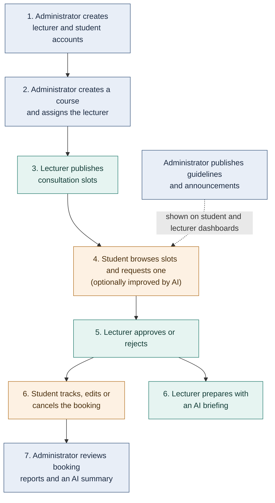
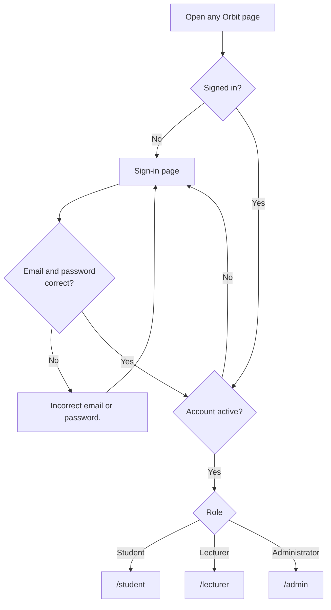
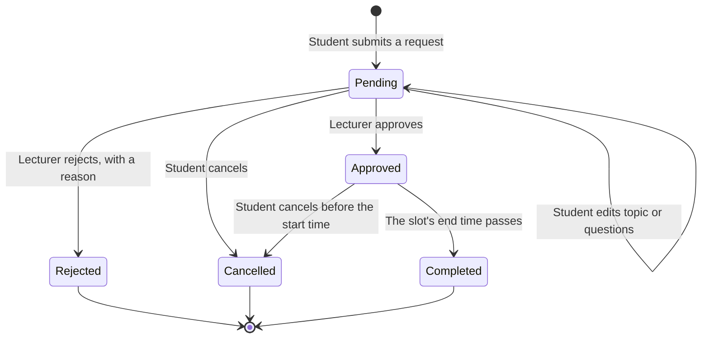
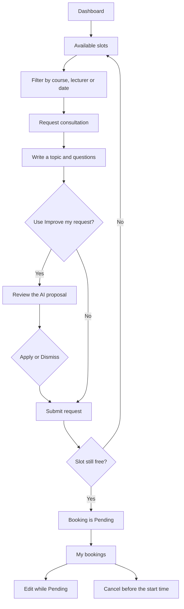
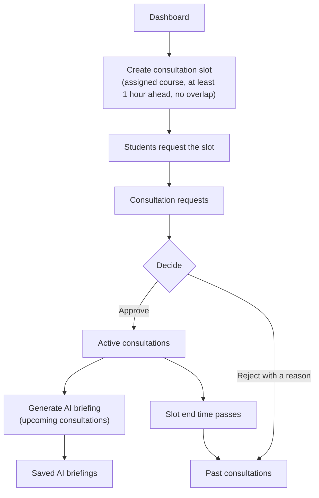
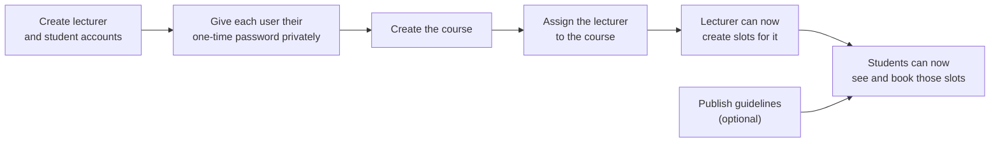
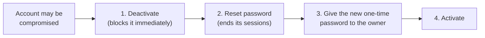
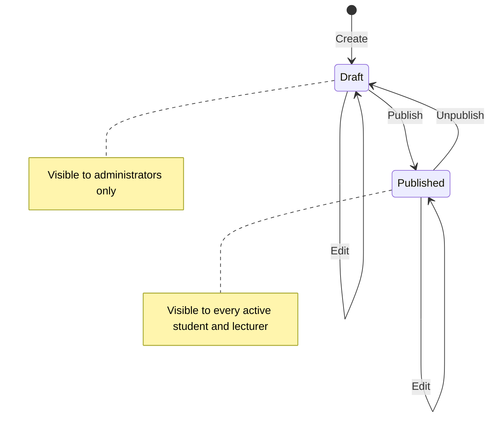
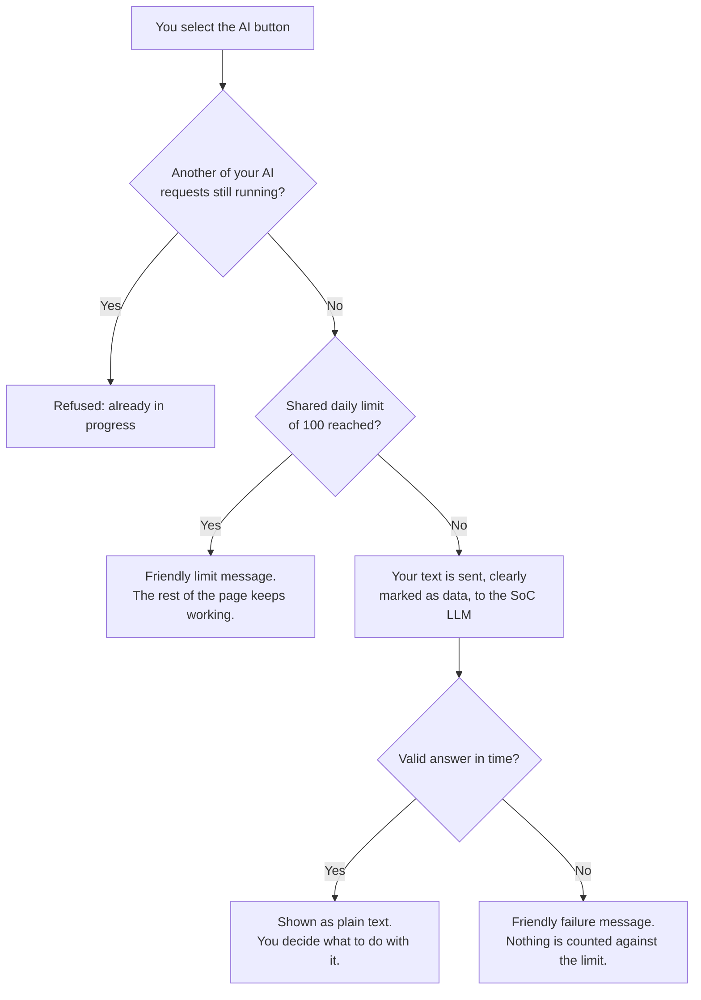

# Orbit User Guide

| Document         | Orbit User Guide                                                                         |
| ---------------- | ---------------------------------------------------------------------------------------- |
| Product release  | Release 1 (CS3227 MP3)                                                                   |
| Last updated     | 22 October 2026                                                                          |
| Audience         | Students, lecturers, administrators, and peer testers                                    |
| Section owners   | Student: Joseph · Lecturer: Jordan · Administrator and shared sections: Johannsen        |
| Related document | [Developer Guide](DeveloperGuide.md) for architecture, security design and the processes |

## Contents

1. [Introduction](#1-introduction)
2. [Getting started](#2-getting-started)
3. [Consultation bookings at a glance](#3-consultation-bookings-at-a-glance)
4. [Student](#4-student)
5. [Lecturer](#5-lecturer)
6. [Administrator](#6-administrator)
7. [AI features](#7-ai-features)
8. [Message reference](#8-message-reference)
9. [Troubleshooting and FAQ](#9-troubleshooting-and-faq)
10. [Known limitations](#10-known-limitations)
11. [Glossary](#11-glossary)

> **Diagrams.** This guide uses Mermaid diagrams. They render on GitHub and on the product
> website. In other Markdown viewers you may see the diagram source as a code block instead.

## 1. Introduction

Orbit is a consultation booking system. Students book consultation slots with their lecturers,
lecturers publish their availability and decide requests, and administrators manage accounts,
courses, guidelines/announcements and activity reports. Each role has one AI feature that helps
with its main task. The AI only suggests; a person always decides.

### 1.1 How the three roles work together

Blue steps are done by administrators, green by lecturers and orange by students.

### 1.2 What each role can do

| Capability                                  | Student |        Lecturer        |     Administrator     |
| ------------------------------------------- | :-----: | :--------------------: | :-------------------: |
| Sign in, sign out, change own password      |   Yes   |          Yes           |          Yes          |
| Browse and filter available slots           |   Yes   |           —            |           —           |
| Request a consultation                      |   Yes   |           —            |           —           |
| Edit (while pending) or cancel own bookings |   Yes   |           —            |           —           |
| AI: Improve my request                      |   Yes   |           —            |           —           |
| Create and delete own consultation slots    |    —    | Yes (assigned courses) |           —           |
| Approve or reject consultation requests     |    —    |    Yes (own slots)     | Yes (any pending one) |
| View active and past consultations          |    —    |          Yes           |           —           |
| AI: consultation briefing                   |    —    |          Yes           |           —           |
| Read guidelines and announcements           |   Yes   |          Yes           | Yes (management page) |
| Manage accounts                             |    —    |           —            |          Yes          |
| Manage courses and lecturer assignments     |    —    |           —            |          Yes          |
| Publish guidelines and announcements        |    —    |           —            |          Yes          |
| Booking reports and AI activity summary     |    —    |           —            |          Yes          |

## 2. Getting started

### 2.1 Opening the app

| Environment | Address                                       | Purpose                            |
| ----------- | --------------------------------------------- | ---------------------------------- |
| Production  | <https://cs3227-2610-mp3.vercel.app>          | The released version               |
| Development | The latest deployment of the `develop` branch | Features under test before release |

Signed-out visitors can only see the sign-in page. Every other address sends you to `/login`.

#### Test accounts for markers and peer testers

Use these accounts to try every role. The data in both environments is fictional.

| Environment | Role          | Email                    | Password           |
| ----------- | ------------- | ------------------------ | ------------------ |
| Production  | Student       | `student@example.com`    | `BkYvP6a2wVVzgwqG` |
| Production  | Lecturer      | `lecturer@example.com`   | `kiNXGd2ukYKiqYaz` |
| Production  | Administrator | `peer-admin@example.com` | `6LRkZU_CTw9NUmJl` |
| Development | Student       | `student@example.com`    | `mBp77HI0zXExqCzV` |
| Development | Lecturer      | `lecturer@example.com`   | `yYp2YY2uXslWEoUq` |

Please do not change these passwords or deactivate these accounts, so that other testers can keep
using them. To try **Change password**, **Reset password** or **Deactivate**, first create your own
account as the administrator and use it instead.

### 2.2 Accounts

There is no self-registration. An administrator creates every account and gives you a one-time
password (see [Administrator](#6-administrator)). Each account has exactly one role: **Student**,
**Lecturer** or **Administrator**.

### 2.3 Signing in

1. Open the app and enter your **Email** and **Password**.
2. Select **Sign in**.
3. You arrive at the page for your role: `/student`, `/lecturer` or `/admin`.

If the email or password is wrong, the page shows **Incorrect email or password.** It does not say
which of the two was wrong. A deactivated account cannot sign in, and an account that is
deactivated while signed in is signed out on its next request.

To sign out, select **Sign out**.

### 2.4 Changing your password

Every signed-in user can change their own password. You should do this after your first sign-in,
because the administrator saw your one-time password.

1. Select **Change password** in the navigation.
2. Enter your **Current password**, a **New password** and **Confirm new password**.
3. Select **Change password**.

Rules:

- The new password must be 12–72 bytes long and different from your current password. Most
  characters count as one byte; some accented and non-Latin characters count as two or more.
- If the current password is wrong, the page shows **Current password is incorrect.** and you
  re-enter all three fields.
- After **5 wrong current passwords within 15 minutes**, further attempts are refused with **Too
  many attempts. Try again in N minutes.** This applies even if the next attempt is correct.

When the change succeeds, the page shows **Password changed**. You stay signed in on this device,
and your other devices are signed out. They may keep working for up to an hour until their current
sign-in expires (see [Known limitations](#10-known-limitations)).

### 2.5 Finding your way around

Every page shares the same layout: a dark sidebar on the left with your role's pages, grouped under
uppercase headings, and a header with your name, role, **Change password** and **Sign out**. On a
narrow screen (below 768 pixels) the sidebar folds into a menu button. Orbit follows your device's
light or dark mode automatically.

| Role          | Sidebar pages                                                                                                  |
| ------------- | -------------------------------------------------------------------------------------------------------------- |
| Student       | Overview: Dashboard · Bookings: Available slots, My bookings                                                   |
| Lecturer      | Overview: Dashboard                                                                                            |
| Administrator | Overview: Dashboard · People: Accounts · Teaching: Courses · Communications: Announcements · Insights: Reports |

All dates and times are shown in **Singapore Time (SGT)**.

## 3. Consultation bookings at a glance

A **booking** is a student's request for one lecturer's consultation slot. Every booking has one
status. The diagram shows how a booking moves between statuses and who moves it.

| Status        | Meaning                                                   | Who can act on it                                   |
| ------------- | --------------------------------------------------------- | --------------------------------------------------- |
| **Pending**   | Waiting for the lecturer's decision. The slot is held.    | Student: edit or cancel. Lecturer or admin: decide. |
| **Approved**  | The consultation will take place.                         | Student: cancel before the start time.              |
| **Rejected**  | The lecturer declined, with a reason the student can see. | Nobody. The slot becomes available again.           |
| **Cancelled** | The student withdrew the request.                         | Nobody. The slot becomes available again.           |
| **Completed** | An approved consultation whose end time has passed.       | Nobody. Shown automatically; nobody has to mark it. |

## 4. Student

The student dashboard (`/student`) greets you by name, shows a count of your upcoming or active
bookings, two quick-action links (**Browse consultation slots**, **My bookings**), and a
**Guidelines and announcements** card (see [Reading guidelines and announcements](#45-reading-guidelines-and-announcements)).

### Typical student journey

### 4.1 Browsing and filtering available slots

**Available slots** (`/student/slots`) lists every open consultation slot — one with no student
already holding a pending or approved booking on it, on an active course with a current (active)
lecturer assignment. Times are shown in Singapore Time (SGT).

- Filter by **Course**, **Lecturer** and/or **Date in Singapore**, then select **Apply filters**.
- **Clear filters** returns to the unfiltered list.
- Each result shows the course, lecturer, start/end time and a slot reference, with a **Request
  consultation** link.
- Results are paginated; select **Load more** to fetch the next page.
- If nothing matches, the page shows **No available slots match these filters.** with a link to
  clear filters.
- Availability is re-checked when you open a slot's request page and again when you submit, so a
  slot can still turn out to be taken by someone else in the meantime.

### 4.2 Requesting a consultation

Selecting **Request consultation** opens `/student/slots/[slotId]/request`, which shows the
selected slot's course, lecturer and start/end time, and a form:

1. Enter a **Consultation topic** (1–200 characters after trimming) and **Questions** (1–2,000
   characters after trimming). Both are required.
2. Optionally select **Improve my request** to get an AI-generated proposal first (see
   [AI: Improve my request](#44-ai-improve-my-request)).
3. Select **Submit request**.

The slot is reserved only once the request is submitted successfully. On success the page shows
**Request submitted — pending lecturer approval**, the booking's status badge, and a booking
reference, with a link back to **Browse available slots**. Submission is safe to retry: if the
result could not be confirmed, the page shows **Retry same request**, which recovers the original
attempt instead of creating a duplicate booking.

If the slot was taken or changed in the meantime, the form shows a message (e.g. "This slot is no
longer available. Your draft is preserved; choose another slot." or "The slot details have
changed. Refresh and review them before submitting again.") without losing what you typed.

### 4.3 Viewing, editing and cancelling bookings

**My bookings** (`/student/bookings`) lists every consultation you have requested, with its
course, lecturer, start time, status badge and topic, and a **View booking** link to its detail
page. If you have none yet, the page shows **You have no consultation bookings yet.** with a link
to browse slots.

On a booking's detail page (`/student/bookings/[bookingId]`) you can see its full course, lecturer,
start/end time, status, topic, questions and, if rejected, the lecturer's **Rejection reason**.

- **Edit booking** appears only while the booking's status is **pending**. It opens an inline form
  for **Topic** and **Questions**; select **Save changes** to submit the edit or **Cancel edit** to
  discard it.
- **Cancel booking** appears while the status is **pending** or **approved**, with the note
  "Cancellation cannot be undone and is available only before the scheduled start." The server
  refuses a cancellation once the slot has started.
- If the booking changed in the background (for example the lecturer just decided it), the page
  shows **This booking changed. Refresh to see its current status.** Edits/cancels are also
  retried automatically if the result could not be confirmed, so you are told to retry the same
  action to recover it rather than risking a duplicate change.

### 4.4 AI: Improve my request

On the request-consultation form, selecting **Improve my request** sends only your current topic
and questions to the AI gateway and returns an editable proposal — it never submits or saves
anything by itself:

- The proposal has its own **Generated topic** and **Generated questions** fields (which you can
  edit) and a plain-text **Suggestions** list.
- **Apply to request** copies the proposal's topic/questions into the ordinary form fields; if you
  changed the form after generating, you are first asked to confirm ("Replace your current
  draft?") before anything is overwritten.
- **Dismiss** discards the proposal only, with no AI call.
- Once a proposal exists, the button becomes **Generate again**; after you apply one, it becomes
  **Generate another suggestion**. Only a fresh **Improve my request**/**Generate again** click
  uses an AI request — Apply and Dismiss never do.
- If the daily AI limit has been reached, the page shows "AI request limit reached. You can still
  write and submit your consultation request manually." and the rest of the form stays usable.

### 4.5 Reading guidelines and announcements

Every dashboard includes a **Guidelines and announcements** card showing every published
guideline and the 5 most recent published announcements (both newest-first), each with its title
and body text (line breaks preserved, never interpreted as HTML or Markdown). If nothing is
published yet, the card shows **No guidelines or announcements yet.**

## 5. Lecturer

The lecturer dashboard (`/lecturer`) is a single page with your slot count, pending-request count,
a slot-creation form, your slot list, the shared **Guidelines and announcements** card, your saved
AI briefings, your active/past consultations, and incoming consultation requests.

### Typical lecturer journey

### 5.1 Creating consultation slots

In **Create consultation slot**, choose a **Course** you are assigned to, a **Date**, **Start
time** and **End time**, then select **Create slot**. Rules enforced on save:

- The slot must start **at least one hour from now**; otherwise: "Slots must be created at least
  one hour before they start."
- The end time must be after the start time, in Singapore time.
- You can only create a slot for a course you are currently assigned to: "You can only use courses
  assigned to you."
- The new slot must not overlap any of your existing slots: "This slot overlaps one of your
  existing slots."

On success the page shows **Consultation slot created.** and the slot appears in **Your
consultation slots**, which otherwise shows **No consultation slots yet.**

### 5.2 Deleting a slot

Select **Delete** next to a slot in **Your consultation slots** to remove it. If the slot still
has a pending or approved booking, deletion is refused with "This slot has active bookings.
Confirm deletion to notify students." — the current dashboard has no way to confirm that
notification, so in practice a slot with an active booking cannot be deleted from the UI; cancel
or resolve the booking first. A slot with no pending/approved booking deletes immediately.

> Editing an existing slot's course/date/time is implemented on the server but is **not currently
> exposed** anywhere in the lecturer dashboard UI — there is no "Edit" control for a slot. Only
> **Create** and **Delete** are reachable today.

### 5.3 Approving or rejecting requests

**Consultation requests** lists every pending request for your slots, each with course, start
time, topic and questions. For each request:

- Choose a **Rejection reason** from the dropdown (**Lecturer unavailable**, **Family or medical
  reasons**, or **Other scheduling reason**) — used only if you reject.
- Select **Approve** or **Reject**.

On success the page shows "Request approved." or "Request rejected.", plus whether the student was
notified immediately or the notification will be retried. If the request was already decided or
changed since the page loaded, you see "This request was already decided or is no longer
available. Refresh and try again." If there are no pending requests, the page shows **No pending
consultation requests.**

### 5.4 Upcoming, ongoing, completed and past consultations

**Lecturer consultations** is split into **Active consultations** (not yet finished — including
upcoming and ongoing approved consultations) and **Past consultations** (rejected, cancelled, or
completed). An **approved** consultation automatically displays as **completed** once its slot's
end time has passed — the system derives this on each view; the stored booking status itself stays
`approved`. Each entry shows the course, topic, time range, student name and email, and the
student's questions, with its status shown as a badge (a rejected entry also shows the rejection
reason).

### 5.5 AI: consultation briefing

For each **upcoming** consultation in **Active consultations**, a **Generate AI briefing** button
appears. Selecting it (shows **Generating briefing…** while in progress) asks the AI gateway for a
plain-text briefing containing a **Summary**, **Grouped question themes** and **Preparation
topics**, built only from that one consultation's course, topic and questions (the student's name
is included; the student's email is excluded from what is sent to the model). Every generated
briefing is saved and shown under **Saved AI briefings** on the dashboard with its save time; the
dashboard displays only the 10 most recent, though every briefing is retained in the database.
Typical failure messages include "Only upcoming approved consultations can be briefed.", "Your
briefing quota has been reached. Please try again later." and "The briefing service is temporarily
unavailable." — ordinary dashboard features keep working regardless.

### 5.6 Announcements card

Like the Student dashboard, the Lecturer dashboard shows the same read-only **Guidelines and
announcements** card described in [Reading guidelines and announcements](#45-reading-guidelines-and-announcements).

## 6. Administrator

The administrator dashboard (`/admin`) greets you by name and shows three stat tiles (**Active
accounts**, **Active courses**, **Pending consultation requests**), three quick-action links
(**Manage accounts**, **Manage courses**, **View reports**), and the full list of pending
consultation requests with **Approve**/**Reject** controls (the same control lecturers use — an
administrator can decide any pending request, not only their own).

### Setting up a new term

Before students can book anything, an administrator prepares accounts and courses in this order:

### 6.1 Finding accounts

**Manage accounts** (`/admin/accounts`) lists every account with its name, email, role and status
(**Active** or **Deactivated**).

- **Search** by part of an email address or name.
- Filter by **Role** (All roles, Student, Lecturer, Administrator) and **Status** (All statuses,
  Active, Deactivated), then select **Search**.
- **Clear filters** shows every account again.

If nothing matches, the page shows **No accounts match these filters.**

### 6.2 Creating an account

1. Select **New account** to open the **Create account** dialog, then enter the **Email**, **Full
   name** and **Role**.
2. Select **Create account**.
3. The dialog shows a **One-time password (copy it now — it cannot be shown again)**. Select
   **Copy**, give the password to the new user through a private channel, then select **Done**.

After **Done**, or if you leave the page, the password cannot be shown again. If it is lost, reset
the password (below). The email must not already be in use; otherwise the page shows **An account
with that email already exists.**

### 6.3 Changing a role

Choose the new role for the account and select **Change role**. The page shows **Role updated.**
Administrators can make other users administrators.

### 6.4 Deactivating and reactivating an account

Select **Deactivate** to block an account immediately: the user is signed out on their next request
and cannot sign in. Select **Activate** to restore it. The account and its history are kept.

### 6.5 Resetting a password

Select **Reset password** for a user who has forgotten their password or whose account may be
compromised. A new one-time password appears with **Copy** and **Done**, as when creating an
account. The user's existing sessions are ended.

For a suspected compromise, **deactivate the account first** (immediate), then reset the password,
then reactivate it.

### 6.6 Rules that protect the system

| You try to…                                                          | Result                                                                |
| -------------------------------------------------------------------- | --------------------------------------------------------------------- |
| Change your own role, deactivate yourself or reset your own password | No controls are shown on your own account; use **Change password**    |
| Demote or deactivate the last active administrator                   | **That change would leave no active administrators and was refused.** |
| Change, deactivate or reset the **Protected** administrator          | No controls are shown for it                                          |

The **protected recovery administrator** is the first administrator account in each environment.
Nobody can demote, deactivate or reset it from the app, so the system always has one administrator
account to recover from. Its owner can still change its password with **Change password**.

### 6.7 Courses and lecturer assignments

**Courses** (`/admin/courses`) manages the course catalogue and which lecturers currently teach
each course.

- **Search** by code or name, filter by **Status** (All statuses, Active, Deactivated), then select
  **Search**; **Clear filters** resets it.
- Select **New course** to open a dialog with **Code** (2–20 characters: letters, numbers, `/`,
  `-` or `_`, unique across every course whether active or deactivated) and **Name** (1–200
  characters), then select **Create course**. A duplicate code shows "A course with that code
  already exists (active or deactivated)."
- Each course row shows its code, name, an **Active**/**Deactivated** badge, and its currently
  assigned lecturer(s) with a per-lecturer **Remove** button, an **Assign lecturer** dropdown
  (only active lecturer accounts appear, and it reads "No eligible lecturers" once every eligible
  lecturer is already assigned) with an **Assign** button, an **Edit** control for the code/name,
  and a **Deactivate**/**Reactivate** toggle.
- Deactivating a course keeps the course, its assignments, slots and bookings unchanged, but its
  unbooked future slots stop appearing to students browsing available slots; reactivating restores
  that visibility. Removing a lecturer's assignment similarly preserves every existing booking and
  only stops new slots being created for that pairing; re-assigning the same lecturer later creates
  a new, separate assignment record rather than reviving the old one.
- Assigning a lecturer is refused for an inactive course, a deactivated account, or an account that
  is not a lecturer; assigning the same active pairing twice is refused as a duplicate.

### 6.8 Guidelines and announcements

**Announcements** (`/admin/announcements`) manages standing **guidelines** and time-bound
**announcements** shown to every active user (see
[Reading guidelines and announcements](#45-reading-guidelines-and-announcements)).

- Select **New announcement** to open **Create guideline or announcement**: choose **Kind**
  (**Guideline** or **Announcement**), enter a **Title** (1–120 characters) and **Body** (1–2,000
  characters), then select **Create**. A new item is always created as a **Draft** — it is never
  visible to anyone else until you publish it.
- The list shows every item, published and draft, with its kind, a **Published**/**Draft** badge, a
  one-line body preview (at most 140 characters, line breaks collapsed, with `…` where it is cut),
  an **Edit** button (opens a dialog pre-filled with the current kind, title and body) and a
  **Publish**/**Unpublish** toggle.
- There is **no delete**. Unpublishing immediately hides an item from every reader but keeps the
  row and its history; you can publish it again at any time.
- Title and body are always shown as plain text — never interpreted as HTML, scripts or Markdown,
  even if someone enters markup. Readers see the full body with its line breaks.
- If nothing has been created yet, the page shows **No guidelines or announcements yet.** with a
  **Create one** link that opens the same dialog.

### 6.9 Reports and AI activity summary

**Reports** (`/admin/reports`) shows booking activity for a chosen period — never any student's
name, topic, questions or rejection reason, only counts and catalogue labels.

- Choose a **Period**: **Last 7 days**, **Last 30 days**, or **Custom range** with explicit **Start
  date**/**End date**, then select **Apply**. A custom range must have an end date on or after the
  start date and span at most 92 days, or the page shows "Please choose an end date on or after the
  start date, within a 92-day span." before any query runs.
- The report shows **Total bookings**, and tables **By status** (Pending, Approved, Rejected,
  Cancelled, Completed — all five always shown, zero-filled), **By course** and **By lecturer**
  (only rows with at least one booking), and **By day** (every day in the range, zero-filled).
- A booking is counted on the Singapore day its **slot starts**, not the day it was requested.
- An **approved** booking whose slot has already ended is counted as **Completed** in the report
  (matching what lecturers see on their dashboard), not as **Approved**; its stored status is
  unaffected.

Selecting **Summarise this period** asks the AI gateway for a short, plain-text **AI-generated —
advisory** summary (at most 1,200 characters, truncated at a word boundary if needed) comparing the
shown period to the immediately preceding period of equal length. The summary is built only from
the same aggregate counts and course/lecturer labels shown in the report — never from any
individual booking, student, topic or question — and is never saved: each click regenerates it.
If the AI service has no key configured locally, or any other AI failure occurs, the panel shows a
message such as "AI summary unavailable: the AI service is not configured." and the report itself
is unaffected.

## 7. AI features

Orbit has one AI feature per role, all going through the same server-side gateway:

| Role          | Feature                             | What it does                                                                                | What is sent to the AI                                                          |
| ------------- | ----------------------------------- | ------------------------------------------------------------------------------------------- | ------------------------------------------------------------------------------- |
| Student       | **Improve my request**              | Suggests a clearer topic/questions and optional suggestions for an unsaved draft request    | Your current topic and questions only                                           |
| Lecturer      | **Generate AI briefing**            | Summarises one approved consultation into a summary, question themes and preparation topics | That consultation's course, topic, questions and student name (never the email) |
| Administrator | **Summarise this period** (Reports) | Summarises the report's aggregate counts, comparing the period shown to the one before it   | Counts and course/lecturer names only                                           |

### 7.1 What happens when you use an AI feature

### 7.2 Shared behaviour

- **Shared daily limit.** All three features draw on one shared capacity of **100 successful AI
  responses per Singapore calendar day across the whole app** (the limit resets at midnight
  Singapore time, not 24 hours after your request). A request that is refused, fails, or times out
  does not use up any of that capacity.
- **One request at a time per user.** Only one of your AI requests can be in flight at once; a
  second click while one is still running is refused with an "already in progress"/"already being
  improved" message rather than starting a second call.
- **Untrusted data stays data.** Anything a student or course record contributes (topics,
  questions, course/lecturer names) is clearly wrapped as data before it reaches the model, with
  fixed instructions telling the model never to treat that content as instructions. The model
  output itself is always rendered as plain text, never as HTML or Markdown, so it cannot inject
  scripts or formatting.
- **AI never changes data.** None of the three features can approve, reject, create, edit, cancel,
  complete, publish or delete anything; they only read data and return advisory text for a human to
  review.
- **Failures never block ordinary features.** If the AI service is not configured, times out, is
  rate-limited, or the shared daily limit is reached, every feature shows a plain, friendly message
  (e.g. "AI summary unavailable: the shared daily AI limit has been reached. Please try again
  later.") and booking, slot, account, course and announcement features keep working normally.

## 8. Message reference

The messages you are most likely to see, what they mean, and what to do.

| Where           | Message                                                                                      | What to do                                                                       |
| --------------- | -------------------------------------------------------------------------------------------- | -------------------------------------------------------------------------------- |
| Sign in         | Incorrect email or password.                                                                 | Check both fields. If you forgot the password, ask an administrator to reset it. |
| Change password | Current password is incorrect.                                                               | Re-enter all three fields.                                                       |
| Change password | Too many attempts. Try again in N minutes.                                                   | Wait the stated time. The limit is 5 wrong tries in 15 minutes.                  |
| Available slots | No available slots match these filters.                                                      | Select **Clear filters** or try another date.                                    |
| Request form    | This slot is no longer available. Your draft is preserved; choose another slot.              | Pick another slot; your text is kept.                                            |
| Request form    | The slot details have changed. Refresh and review them before submitting again.              | Refresh, check the new time, then submit.                                        |
| Request form    | AI request limit reached. You can still write and submit your consultation request manually. | Submit without AI, or try after midnight SGT.                                    |
| Booking details | This booking changed. Refresh to see its current status.                                     | Refresh the page.                                                                |
| Lecturer slots  | Slots must be created at least one hour before they start.                                   | Choose a later start time.                                                       |
| Lecturer slots  | You can only use courses assigned to you.                                                    | Ask an administrator to assign you to the course.                                |
| Lecturer slots  | This slot overlaps one of your existing slots.                                               | Choose a time that does not overlap.                                             |
| Lecturer slots  | This slot has active bookings. Confirm deletion to notify students.                          | Resolve the booking first; see [Deleting a slot](#52-deleting-a-slot).           |
| Requests        | This request was already decided or is no longer available. Refresh and try again.           | Refresh the page.                                                                |
| AI briefing     | Only upcoming approved consultations can be briefed.                                         | Briefings are for upcoming approved consultations only.                          |
| AI briefing     | Your briefing quota has been reached. Please try again later.                                | Try again after midnight SGT.                                                    |
| Accounts        | An account with that email already exists.                                                   | Search for the existing account instead.                                         |
| Accounts        | That change would leave no active administrators and was refused.                            | Make another user an administrator first.                                        |
| Courses         | A course with that code already exists (active or deactivated).                              | Use a different code, or reactivate the existing course.                         |
| Reports         | Please choose an end date on or after the start date, within a 92-day span.                  | Fix the date range.                                                              |
| Reports         | AI summary unavailable: the AI service is not configured.                                    | The AI key is not set in this environment; the report still works.               |

## 9. Troubleshooting and FAQ

**I forgot my password.** Ask an administrator to reset it. They will give you a new one-time
password; change it after you sign in.

**A slot I saw a moment ago has disappeared.** Another student may have requested it, the course
may have been deactivated, or the lecturer may no longer be assigned to the course. Choose another
slot.

**I cannot edit my booking.** Editing is only possible while the booking is **Pending**. After the
lecturer decides, you can still cancel an approved booking before it starts.

**I cannot cancel my booking.** Cancelling is refused once the slot's start time has passed.

**A consultation shows as Completed, but nobody marked it.** That is expected. An approved
consultation is shown as completed once its end time passes.

**The AI feature says the limit has been reached.** The whole app shares 100 successful AI
responses per Singapore day. Everything else keeps working; the limit resets at midnight SGT.

**My other device is still signed in after I changed my password.** It stays signed in for up to
an hour and then has to sign in again. An administrator can deactivate an account to block it
immediately.

**Which time zone is used?** Singapore Time (SGT), everywhere in the app.

## 10. Known limitations

- After a password change or reset, other devices can stay signed in for up to one hour, until
  their current sign-in expires. They cannot renew it. To lock someone out immediately, an
  administrator deactivates the account.
- Public sign-up through the Supabase API is still enabled; the app itself offers no sign-up page.
- The administrator dashboard currently shows the text of pending consultation requests; a privacy
  review of this is planned.
- Editing an existing lecturer slot is implemented on the server but has no control in the current
  lecturer dashboard UI (see [Deleting a slot](#52-deleting-a-slot)).

## 11. Glossary

| Term                             | Meaning                                                                                         |
| -------------------------------- | ----------------------------------------------------------------------------------------------- |
| Slot                             | A time a lecturer offers for one consultation, for one course.                                  |
| Booking                          | A student's request for a slot, with a topic and questions. It has one status at a time.        |
| Consultation                     | An approved booking: the meeting itself.                                                        |
| Assignment                       | The link between a lecturer and a course. A lecturer can only offer slots for assigned courses. |
| Guideline                        | Standing advice from administrators, always shown on dashboards while published.                |
| Announcement                     | Time-bound news from administrators. Dashboards show the 5 most recent published ones.          |
| Draft                            | A guideline or announcement that only administrators can see.                                   |
| One-time password                | The password an administrator sees once when creating or resetting an account.                  |
| Protected recovery administrator | The first administrator account. It cannot be demoted, deactivated or reset from the app.       |
| AI briefing                      | A lecturer's AI-generated preparation notes for one upcoming consultation.                      |
| Shared daily AI limit            | 100 successful AI responses per Singapore day, shared by every user and every AI feature.       |
| SGT                              | Singapore Time (UTC+8), used for every date and time in Orbit.                                  |
